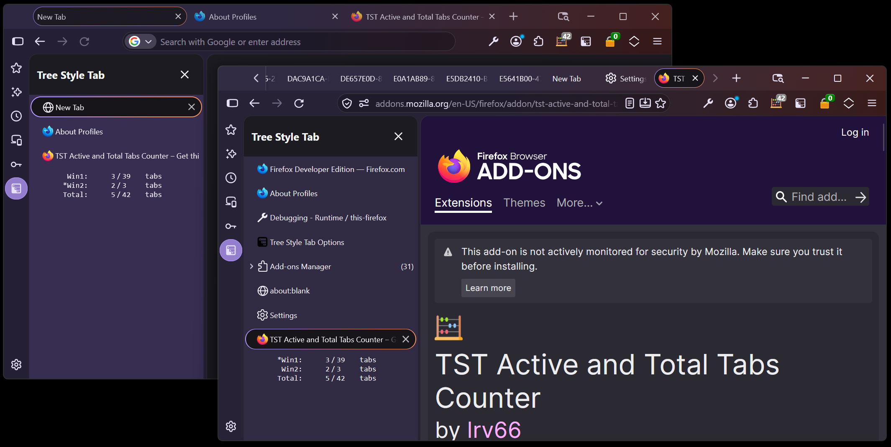
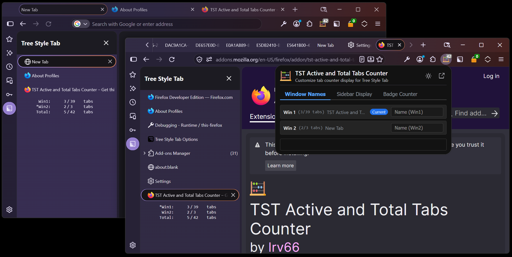
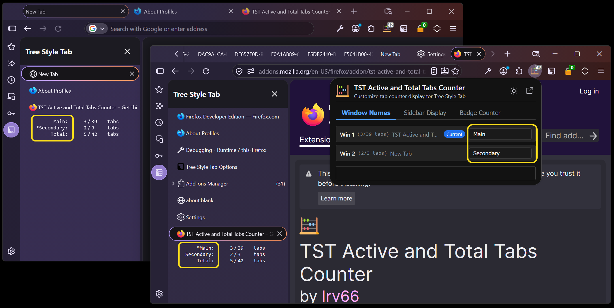
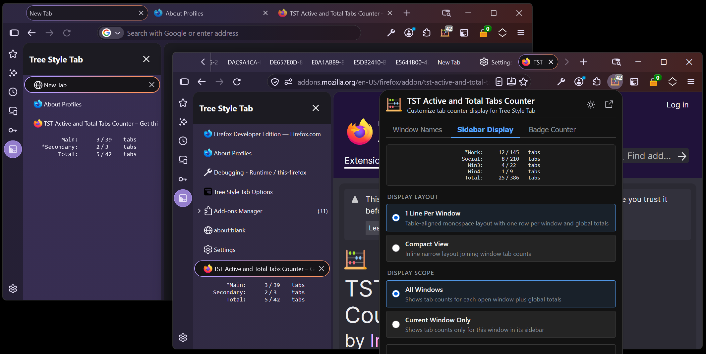
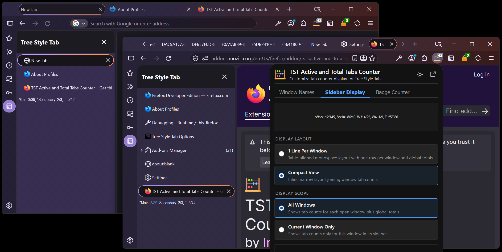
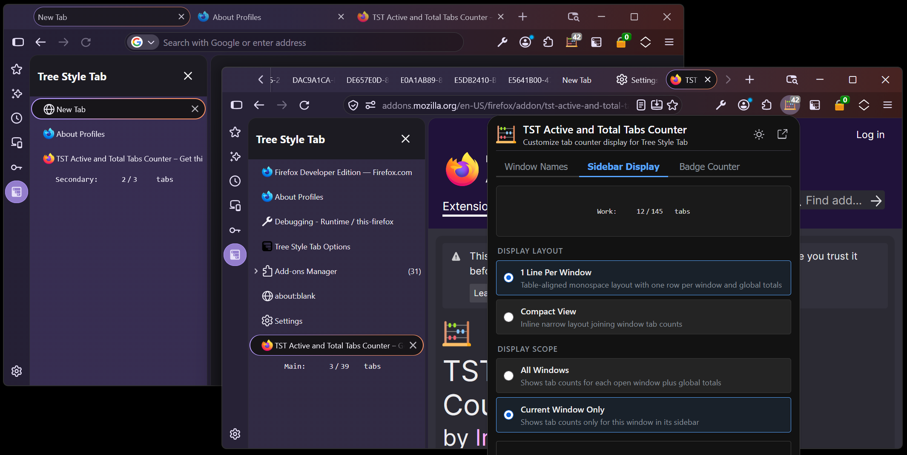
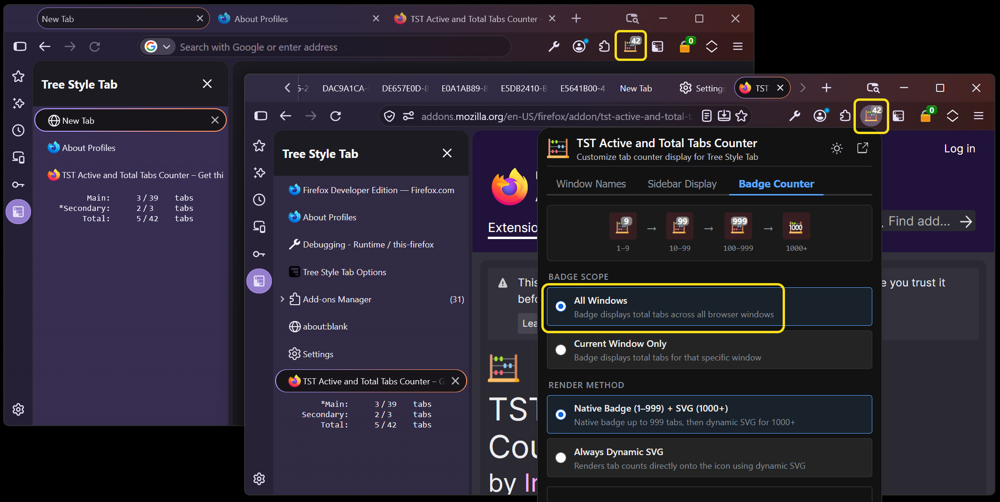
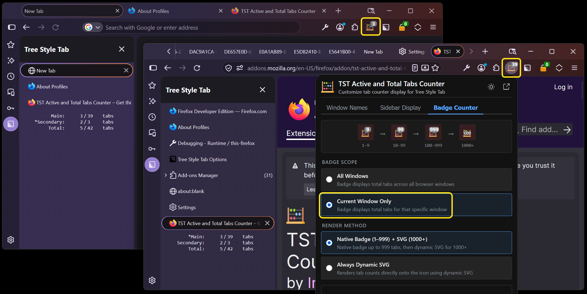
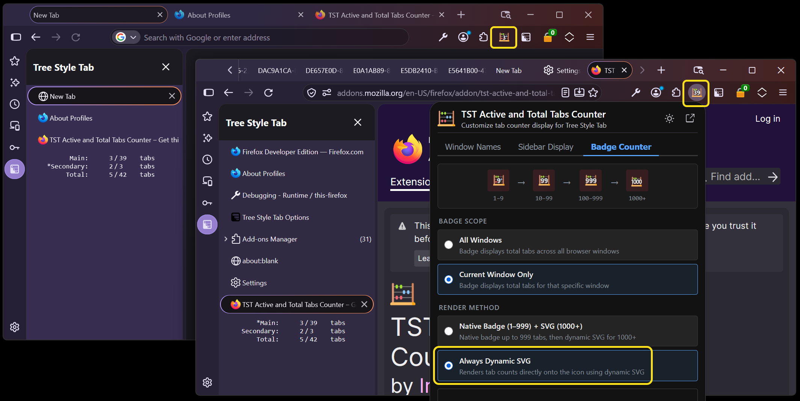

  

# TST Active and Total Tabs Counter

Tracks and displays active (non-discarded) and total tabs directly above the "New Tab" button in Tree Style Tab (TST) and on the browser toolbar badge.

## Core Capabilities
- **Active & Total Tab Tracking**: Counts loaded tabs and total tabs per window and across all open windows.
- **Custom Window Naming**: Assign persistent names to windows directly from the popup settings; names reflect immediately in TST sidebars.
- **Configurable Sidebar Layouts**: Choose between an aligned monospace table (**1 Line Per Window**) or narrow continuous inline (**Compact View**).
- **Flexible Scopes**: View tab counts across **All Windows** (with an active window indicator `*`) or strictly for the **Current Window**.
- **Toolbar Badge Counter**: Show the current window's count or global total, with dynamic SVG badge rendering for up to 4 digits (up to 9,999 tabs).
- **Standalone Support**: Functions as a toolbar tab counter even when Tree Style Tab is disabled or not installed.

---

## Features & Visual Walkthrough

### 🏷️ Custom Window Naming
Assign custom names to your Firefox windows (e.g., `Main` and `Secondary`) in the **Window Names** tab. Names update across Tree Style Tab sidebars in real time as you type and persist across browser restarts.

#### Default Window Names View
Displays window indices, active tab title previews, and the current window indicator dot:

#### Custom Window Names Assigned
Typing custom names immediately updates the labels in each Tree Style Tab sidebar in real time:

---

### 📊 Tree Style Tab Sidebar Display Styles
Customize the layout and scope of the tab counter rendered in the Tree Style Tab sidebar via the **Sidebar Display** tab.

#### 1 Line Per Window (Monospace Table)
Aligned tabular layout showing active and total tabs for each window, with an asterisk (`*`) designating the currently focused window:

#### Compact View (Continuous Inline)
Narrow, space-saving format grouping window statistics into a single continuous row:

#### Current Window Only Scope
Isolate the sidebar counter display strictly to the tabs belonging to the current window:

---

### 🔢 Toolbar Badge Counter Options
Configure toolbar badge behavior, scope, and rendering modes via the **Badge Counter** tab.

#### All Windows Scope (Global Total)
Badge displays the cumulative tab count across all open browser windows (e.g., `42` total tabs across both windows):

#### Current Window Only Scope (Dynamic Focus Tracking)
Badge dynamically switches to show the count for the currently active window (e.g., `39` on the Main window, `3` on the Secondary window):

#### Dynamic SVG Rendering (1,000 to 9,999 Tabs)
Firefox native badges truncate at 3 characters. Choosing **Always Dynamic SVG** (or the default Hybrid mode) renders crisp numeric counts directly on the icon, supporting 4 digits (up to 9,999 tabs) without clipping:

---

## Private Windows Setup
To enable this extension to count tabs inside Private Windows:
1. **Allow Extension in Private Windows**:
   * Navigate to `about:addons` ➔ **TST Active and Total Tabs Counter** ➔ toggle **Run in Private Windows** to **Allow**.
2. **Enable TST Inter-Extension Messaging**:
   * Navigate to **Tree Style Tab Options** ➔ **Extra Features via Other Extensions** ➔ enable **Notify Message from Private Windows for "TST Active and Total Tabs Counter"** ➔ restart TST or Firefox.

---

## Background & History
Older versions of TST could accomplish tab counting with custom CSS. However, as of TST v4.0 ([GitHub Release](https://github.com/piroor/treestyletab/releases/tag/4.0.1)), internal architectural and performance improvements made pure CSS counting impossible ([TST Discussion #3472](https://github.com/piroor/treestyletab/discussions/3472)). This addon restores and expands that functionality via official TST extension messaging APIs.

Addon icon provided by: <a href="https://www.flaticon.com/free-icons/school-material" title="school-material icons">School-material icons created by Freepik - Flaticon</a>

---

## Version History

<b>Version 1.1.0 (October 29, 2026) - Custom Window Names, Scope Controls, Tabbed Settings UI & Test Suite</b>

- **Custom Window Naming**: Assign custom, persistent names to Firefox windows with inline popup editing; custom window names update in real time across the TST sidebar display and persist across browser restarts.
- **Tabbed Settings Popup UI**: Completely redesigned extension popup into an intuitive 3-tab layout (*Window Names*, *Sidebar Display*, and *Badge Counter*) with smooth transitions and compact styling.
- **Sidebar Display Scope**: Configure whether the TST sidebar counter displays tab counts across all open windows or strictly for the current window.
- **Current Window Indicator**: In multi-window "All Windows" mode, prepends an asterisk (`*`) to the current window's row in each sidebar to visually distinguish the active window.
- **Toolbar Badge Scope**: Choose whether the extension toolbar badge displays the total count across all windows or the count for the current window only.
- **Layout Preview**: Added a live text preview in the popup demonstrating the selected sidebar display format and scope.
- **Theme & Header Controls**: Added dark/light theme switching with saved preference, direct "Open in separate tab" shortcut button, and header actions matching TST Lock design.
- **Badge Synchronization & Standalone Mode**: Fixed badge count synchronization on browser startup, debounced tab closures/removals, and ensured reliable standalone operation when Tree Style Tab is disabled or inactive.
- **Unit Test Suite**: Added a comprehensive Jest test suite (123+ unit tests) covering background logic, popup interactions, and badge calculations with CI integration.
- **Manifest Permissions**: Added `sessions` and `tabs` permissions for window naming and synchronization.
- **Build & Lint Tooling**: Integrated `web-ext` build and lint pipeline (`npm run build`, `npm run lint`) matching TST Lock standards, updated Firefox ESR min-version baseline (115.0), resolved all DOM parser lint warnings, and modernized GitHub Actions CI/CD.

<b>Version 0.9.10 (August 26, 2026) - TST 4.4.1+ Compatibility & AMO Compliance</b>

- **TST 4.4.1+ Compatibility & Spacing**: Updated button layout and vertical alignment for Tree Style Tab 4.4.1+, including caret action selector button alignment and exact sidebar spacing matching TST standards.
- **Manifest & AMO Compliance**: Declared Firefox `data_collection_permissions` in manifest.json for AMO compliance.

<b>Version 0.9.9 (July 27, 2024) - Compact View Layout & Popup Styling</b>

- **Compact View Layout**: Added a space-saving compact display option inside the Tree Style Tab sidebar featuring a narrow font, self-adjusting button height, non-wrapping window text, and dynamic adjustment on sidebar resize.
- **Display Style Option**: Added popup selection allowing users to choose between the classic "1 Line Per Window" monospace table and the new "Compact View" layout.
- **Popup Stylesheet**: Introduced `popup.css` for popup interface styling and asset packaging.

<b>Version 0.9.8 (July 1, 2024) - Dynamic SVG Badge Rendering & Security Hardening</b>

- **Dynamic SVG Badge**: Added dynamic SVG rendering for toolbar badge counts to cleanly display counts of 1,000+ tabs beyond native badge 3-character limitations.
- **Badge Render Modes**: Allowed choosing between Native (1–999) + SVG (1000+) or Always SVG rendering.
- **Security Hardening**: Replaced `innerHTML` usage with safe DOM manipulation to address AMO security warnings.
- **Build Pipeline**: Included popup assets into the extension packaging build scripts.

<b>Version 0.9.7 (June 23, 2024) - Diagnostic Logging & Link Fixes</b>

- **Logging & Timing**: Added structured diagnostic logging and adjusted retry sleep schedule.
- **Documentation**: Fixed counter badge image URLs in README.md.

<b>Version 0.9.6 (June 23, 2024) - Async Optimization</b>

- **Async Timing**: Added `await` to asynchronous sleep calls and removed redundant `updateTabCount()` invocations.

<b>Version 0.9.5 (June 23, 2024) - Extended Startup Retries</b>

- **Startup Resiliency**: Extended startup retry attempts up to 15 seconds to ensure reliable connection with Tree Style Tab during delayed browser starts.

<b>Version 0.9.4 (June 23, 2024) - Initial State Synchronization</b>

- **State Timing**: Added delayed calls to ensure initial tab state is properly loaded into TST.

<b>Version 0.9.3 (June 23, 2024) - Secondary Registration Fallback</b>

- **Registration Fallback**: Added a 3-second delayed secondary registration call to resolve intermittent startup communication issues.

<b>Version 0.9.2 (June 23, 2024) - Registration Retry Logic</b>

- **Connection Resiliency**: Added retry logic if initial registration with Tree Style Tab fails.

<b>Version 0.9.1 (June 23, 2024) - Registration Identifier</b>

- **Registration Metadata**: Updated extension registration name used during TST communication.

<b>Version 0.9.0 (June 22, 2024) - Initial Release</b>

- **Core Functionality**: Injected active and total tab counter display into the Tree Style Tab sidebar above the new-tab button.
- **Multi-Window Counting**: Tracked active (non-discarded) and total tabs per window and across all open windows.
- **Toolbar Badge**: Added dynamic badge counter to the extension toolbar button displaying total tabs.
- **Build & CI Automation**: Established automated XPI build scripts and GitHub Actions CI/CD pipeline.

